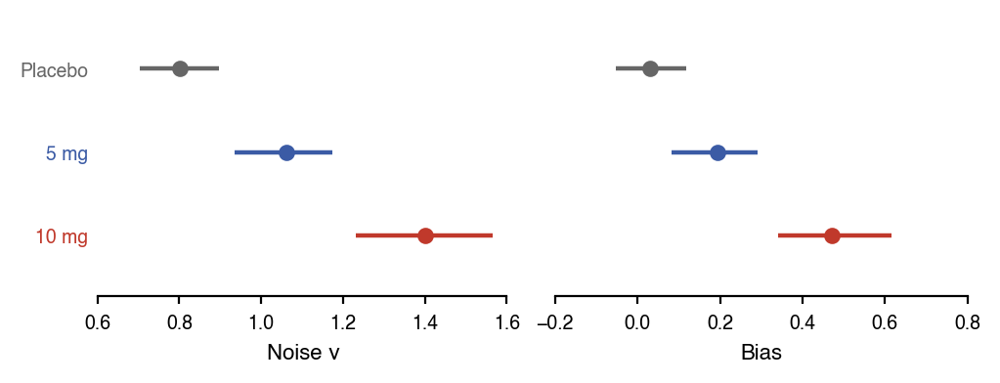
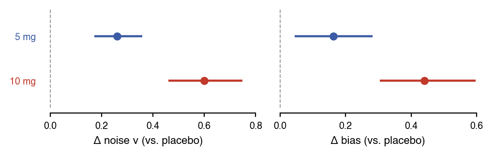
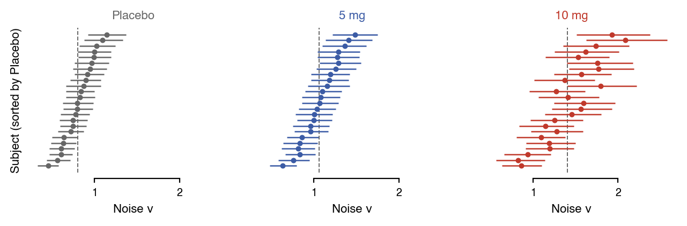
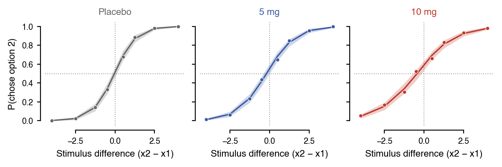
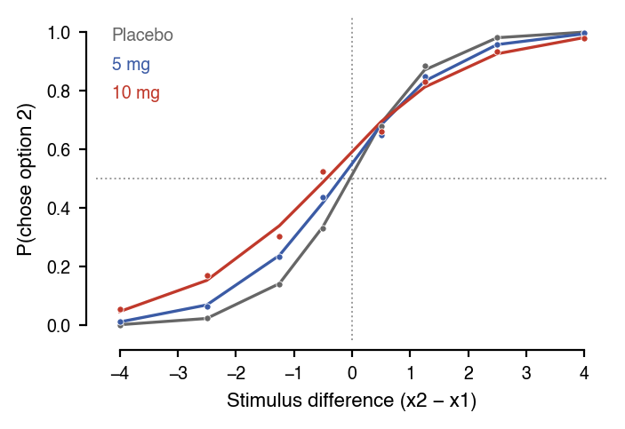
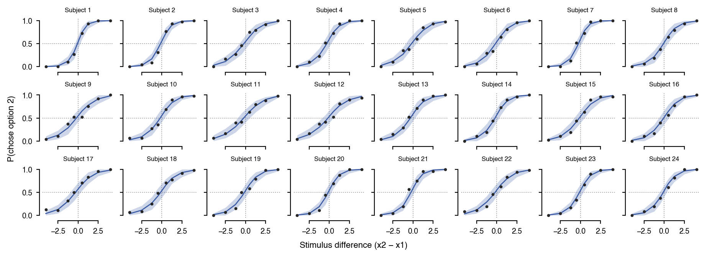

=====
Usage
=====

To use bauer in a project::

    import bauer

Fitting a model is covered in :doc:`concepts` and the :doc:`tutorial/index`. This page
shows what to do with a fitted model: check it, summarise it and plot it.

.. _summarising-posteriors:

Summarising and plotting posteriors
-----------------------------------

The helpers in :mod:`bauer.utils` share one convention: **posterior draws live in a
long DataFrame**, one row per draw, with columns ``chain``, ``draw``, the grouping
columns (``parameter``, and where relevant ``subject`` and your condition columns) and
the number in ``value``. Every quantity is summarised the same way, as the **posterior
mean plus a 95% highest-density interval (HDI)**. Transformations and contrasts are
computed *per draw* before summarising, so the interval of a difference is the
interval of the difference, not a difference of intervals.

Where draws come from:

- :meth:`RegressionModel.conditionwise_draws <bauer.core.RegressionModel.conditionwise_draws>`
  for regression models. It evaluates the formulas at the conditions you pass (one row
  per condition, with every column the formulas use), applies each parameter's link
  function and returns natural-scale draws. Use it instead of reading raw regression
  coefficients, which live on the untransformed (pre-softplus / pre-logistic) scale.
- :func:`~bauer.utils.summaries.posterior_draws` for plain variables, e.g. the
  subject-level ``nu`` (dims ``chain, draw, subject``) or the group mean ``nu_mu``.

The plots share their vocabulary: ``by`` (the column that defines rows or panels,
default ``'condition'``), ``order``, ``palette`` (a dict level → colour, or one colour),
``level_labels`` and ``xlabel`` / ``xlabels``.

The figures below come from a **simulated** experiment: 24 participants, each doing a
two-alternative discrimination task under placebo, 5 mg and 10 mg in each of two
sessions, where the higher doses increase both noise and bias. ``docs/make_usage_figures.py``
regenerates them.

Convergence first
~~~~~~~~~~~~~~~~~

.. code-block:: python

    from bauer.utils import convergence_report

    diag = convergence_report(idata)   # r̂, bulk ESS, divergences of every *_mu / *_sd
    # Max r̂ = 1.004 (want ≤ 1.01; worst: nu_sd), min bulk ESS = 1210 (want ≥ 400),
    # divergences = 0 (want 0)  →  OK
    diag.attrs['ok']                   # the verdict as a bool

Group level: forest plot and contrasts
~~~~~~~~~~~~~~~~~~~~~~~~~~~~~~~~~~~~~~

For a regression model such as
``PsychophysicalRegressionModel(paradigm=df.reset_index(), fixed_regressors={'nu': F,
'bias': F}, random_regressors={'nu': F, 'bias': F})`` with
``F = "C(condition, Treatment('placebo')) + session_c"``:

.. code-block:: python

    import pandas as pd
    from bauer.utils import summarize_posterior, contrast_draws, plot_forest

    CONDITIONS = ['placebo', '5 mg', '10 mg']
    PALETTE = {'placebo': '0.4', '5 mg': '#3B5BA5', '10 mg': '#C0392B'}
    COND = dict(order=CONDITIONS, palette=PALETTE, level_labels={'placebo': 'Placebo'})

    # One row per condition; session_c = 0 is "an average session"
    conds = pd.DataFrame({'condition': CONDITIONS, 'session_c': 0.0})
    draws = model.conditionwise_draws(idata, conds, parameters=['nu', 'bias'])

    group = summarize_posterior(draws, ['parameter', 'condition'])   # mean, lo, hi, p_positive
    plot_forest(group, ['nu', 'bias'], xlabels={'nu': 'Noise ν', 'bias': 'Bias'}, **COND)

    # Each condition minus placebo, per draw; p_positive = P(effect > 0)
    effects = summarize_posterior(contrast_draws(draws, 'condition', 'placebo'),
                                  ['parameter', 'condition'])
    plot_forest(effects, ['nu', 'bias'], ref=0,
                xlabels={'nu': 'Δ noise ν (vs. placebo)', 'bias': 'Δ bias (vs. placebo)'}, **COND)

   ``plot_forest`` on the group-level summary. Dot = posterior mean, line = 95% HDI.

   The same plot for the contrasts against placebo, with ``ref=0`` marking no effect.

``summarize_posterior`` needs every column that distinguishes rows *within* a draw in
``by``; it warns if you forget one rather than silently pooling. ``contrast_draws``
raises if a column other than the contrasted one varies (e.g. different ``session_c``
per condition); drop it or pass it in ``keys``. In simulations, add the true values
as a column and pass ``true_col='true'`` to draw them as open circles.

Subject level: sorted forest plot
~~~~~~~~~~~~~~~~~~~~~~~~~~~~~~~~~

.. code-block:: python

    from bauer.utils import plot_sorted_forest

    subj = summarize_posterior(
        model.conditionwise_draws(idata, conds, parameters=['nu'], group=False),
        ['parameter', 'subject', 'condition'])
    plot_sorted_forest(subj, 'nu', 'Noise ν', sort_by='placebo', group_summary=group, **COND)

   ``plot_sorted_forest``: every participant's noise in each condition.

One panel per condition, one row per participant (dot = posterior mean, line = 95%
HDI). Participants are sorted once, by their ``sort_by`` value, and keep their row in
every panel; the dashed line is the group mean. For a parameter with one value per
participant (e.g. a lapse rate) pass ``by=None``. For a non-regression model, build
the summary from :func:`~bauer.utils.summaries.posterior_draws`::

    subj = summarize_posterior(posterior_draws(idata, ['nu']), ['parameter', 'subject'])
    plot_sorted_forest(subj, 'nu', 'Noise ν', by=None)

Posterior predictive checks
~~~~~~~~~~~~~~~~~~~~~~~~~~~

``model.ppc(data, idata)`` returns one row per trial × posterior-predictive sample
(index = the data index + ``ppc_sample``). Summarise each simulated dataset exactly
like the observed one: :func:`~bauer.utils.summaries.ppc_summary` averages within each
subject × cell, then across subjects, per sample, and takes the 95% interval over
samples. The band therefore includes trial-level sampling noise, so about 95% of the
observed cells should fall inside it, which :func:`~bauer.utils.summaries.ppc_coverage`
checks.

.. code-block:: python

    from bauer.utils import (ppc_summary, ppc_observed, ppc_coverage,
                             plot_ppc_panels, plot_ppc_overlay, plot_subject_ppc)

    ppc = model.ppc(df, idata, n_posterior_samples=200)
    ppc = ppc.join(df[['condition', 'delta']]).reset_index()   # needs a unique trial index
    ppc['y'] = ppc['simulated_choice'].astype(float)
    data = df.reset_index().assign(y=lambda d: d['choice'].astype(float))

    # Axis labels, plus dotted reference lines at chance and at no stimulus difference
    AXES = dict(xlabel='Stimulus difference (x2 − x1)', ylabel='P(chose option 2)',
                ref=0.5, xref=0)

    # Group level: data as dots, model as line + 95% band
    pred = ppc_summary(ppc, ['condition', 'delta'], 'y')
    obs = ppc_observed(data, ['condition', 'delta'], 'y')
    print(f"Coverage: {ppc_coverage(pred, obs, ['condition', 'delta']):.0%}")
    plot_ppc_panels(pred, obs, 'delta', **COND, **AXES)
    plot_ppc_overlay(pred, obs, 'delta', **COND, **AXES)

    # Subject level: small multiples, one panel per participant
    pred_s = ppc_summary(ppc, ['delta'], 'y', subject_level=True)
    obs_s = ppc_observed(data, ['delta'], 'y', subject_level=True)
    print(f"Coverage: {ppc_coverage(pred_s, obs_s, ['subject', 'delta']):.0%}")
    plot_subject_ppc(pred_s, obs_s, 'delta', **AXES)

   ``plot_ppc_panels``: observed choices (dots) against the model (line + 95% band).

   ``plot_ppc_overlay``: the same curves on one axis, to compare conditions directly.

   ``plot_subject_ppc``: one panel per participant.

The same works for any simulated quantity: ``simulated_rt`` from the DDM / race
models, ``simulated_response`` from :class:`~bauer.models.ReproductionModel`, or a
derived per-trial value (an error, a log-ratio, ...).

Figure style
~~~~~~~~~~~~

The plotting functions return the matplotlib ``Figure``. Their default sizes are set
for print (7–8 pt text); call :func:`~bauer.utils.plotting.set_house_style` once at the
top of a notebook for matching fonts, despined axes and editable PDF text, or pass
``figsize=`` for larger on-screen figures.

Lesson 1 of the :doc:`tutorial/index` uses these helpers on real data (subject-level
noise, group-level and subject-level PPCs); lessons 2 and 8 use
``conditionwise_draws`` and ``contrast_draws`` for a regression effect.
